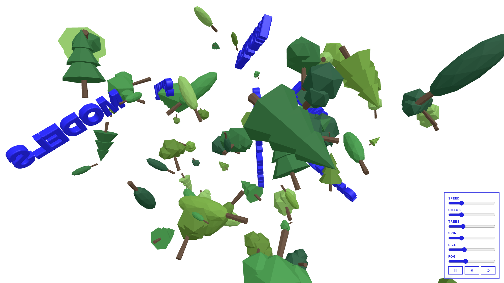

**Project Description**
Please include a description of your project that is at least four sentences. Include a definition of your project as a simulation, a model, or a digital twin.

**Development Process**
Briefly describe how you made the project: where you started, what you tried, what changed along the way, and which tools you used.

**Assumptions and Limitations**
Describe the assumptions your project makes and what it can't see or say. This project does not claim objectivity; say where it stops being reliable.

**Datasets and Citations**
List every dataset you used, with where you got it and when, followed by your other sources. Use Chicago Author-Date style, e.g.:

NYC Department of City Planning. 2025. "MapPLUTO, Release 25v1." NYC Open Data. Accessed October 20, 2026. https://www.nyc.gov/site/planning/data-maps/open-data.page.

---

#### Formatting guide (delete everything below the line before you submit)

This file is written in markdown, a way of formatting plain text that the course site turns into a web page. [This guide](https://www.markdownguide.org/basic-syntax/) covers all of it. The main things:

Start a section with a bold line, like the ones above: `**Section Title**`, with the text on the next line.

Write **bold** with two asterisks on each side, and *italics* with one.

A new line in this file is a new line on the page. Leave an empty line between paragraphs.

Lists:
1. numbered
1. like this (the numbers count themselves)
   1. three spaces in front to indent

- or bullets
- like this
  - two spaces to nest

Links look like this: [Center for Spatial Research](https://c4sr.columbia.edu/).

Images go in the same zip as this file, next to it. Refer to them by file name:

Make images at least 1400px wide. Write a short description of each one inside the square brackets; it is what a screen reader says.

Raw HTML (iframes, embeds, buttons) is not shown. Your interactive, video, or main image goes in the "Cover item" box of the form instead.

To submit: put this file (keep the name `index.md`) and your images in a folder, compress it to a .zip, and upload the zip in the "Write-up" box. With no images, you can upload `index.md` on its own.
